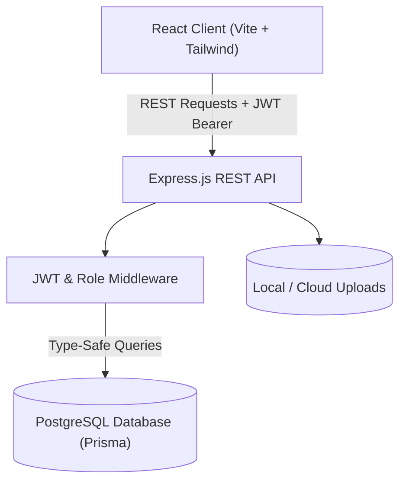

# System Architecture & Technical Specification

## 1. High-Level Overview
CampusFind is designed as a decoupled, multi-tiered full-stack web application:
- **Client Tier:** React 18 Single Page Application (SPA) bundled with Vite, styled with Tailwind CSS, and using React Router for client-side navigation.
- **Server Tier:** Node.js runtime with an Express.js REST API layer handling authentication, business logic, role-based authorization, and anti-fraud verification.
- **Persistence Tier:** PostgreSQL relational database managed through Prisma ORM with automated migrations and connection pooling.

## 2. Directory Layout & Separation of Concerns

### Frontend (`client/src/`)
- `components/common/`: Shared layout and UI widgets (Navbar, Footer, StatsBar, SketchLoader).
- `components/items/`: Item listing and filtering components (ItemCard, CategoryFilterBar, LocationFilterBar).
- `components/modals/`: User action modals (AuthModal, ReportModal, ItemDetailModal, ClaimModal, ActivityModal).
- `context/`: Global state management (`AuthContext`).
- `pages/`: Page-level components (`HomePage`).
- `services/`: Axios HTTP network layer (`api.js`, `authService.js`, `itemService.js`, `claimService.js`).

### Backend (`server/src/`)
- `config/`: Database client & environment settings.
- `controllers/`: HTTP request handlers and input validators.
- `middleware/`: Authentication, authorization, file upload filters, and error handlers.
- `routes/`: Express endpoint routing.
- `services/`: Dedicated business logic (Audit logs, matching logic).
- `utils/`: Standard API response formatting and domain constants.
