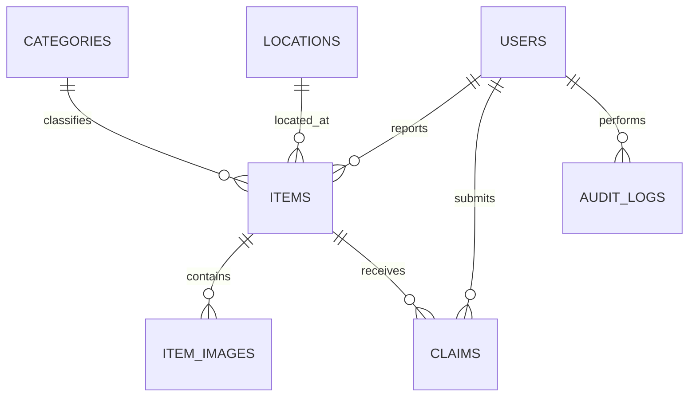

# Database Architecture & Entity Relationships

## 1. Relational Schema Overview
The database uses PostgreSQL with relational integrity, UUID primary keys for security, and foreign key cascades.

### Tables
1. **`users`**: User identity, hashed credentials, roles (`STUDENT`, `SECURITY_STAFF`, `ADMIN`), and contact details.
2. **`categories`**: Standardized item classifications (Electronics, IDs, Keys, Wallets, etc.).
3. **`locations`**: Physical campus zones (Library, Cafeteria, Blocks, Sports Complex) with security desk flags.
4. **`items`**: Lost and found reports, title, description, incident date, status (`OPEN`, `CLAIM_PENDING`, `RESOLVED`), custody type, and anti-fraud proof questions.
5. **`item_images`**: Photo attachments linked to item reports.
6. **`claims`**: Ownership claim attempts, answers to verification questions, and status (`PENDING`, `APPROVED`, `REJECTED`, `COMPLETED`).
7. **`notifications`**: User alerts for claim reviews, handovers, and match suggestions.
8. **`audit_logs`**: Permanent log of logins, registrations, and confirmed handovers.

